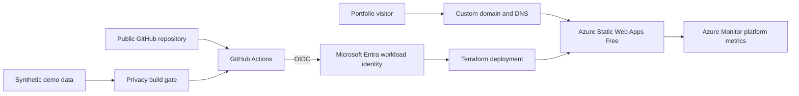

# Azure Wedding Guest Demo

A privacy-safe portfolio implementation of a wedding guest experience deployed through an Azure landing-zone pattern. Every person, date, venue, schedule, and address in this repository is synthetic.

This repository contains the guest-facing website. The separate [operations dashboard demo](https://github.com/vpatel0135/wedding-ops-dashboard-demo) is hosted at [ops.sidvivah26.com](https://ops.sidvivah26.com/).

**Live demo:** [www.sidvivah26.com](https://www.sidvivah26.com/)

**SIT:** `sit.sidvivah26.com` targets the isolated nonproduction Static Web App and is promoted independently from production.

## The problem

The original application addressed a real operational challenge: coordinating a multi-day Indian wedding for approximately 500 guests. The largest risk was miscommunication. Schedule, venue, transportation, and event information could easily become fragmented across group chats, documents, and different family members.

## The solution

Create a central source of truth with two intentionally separate experiences:

- a mobile-first guest site containing the information attendees need; and
- a private operations site containing the more detailed run of show used by immediate family and organizers.

Separating the audiences reduced information overload while ensuring both groups worked from consistent event data.

## The outcome

Guests had one dependable place to find current information, organizers had a shared operational view, and the wedding events proceeded without unexpected operational surprises. The public portfolio version demonstrates the same design with synthetic data, repeatable Azure infrastructure, and a privacy-controlled build pipeline.

## What this demonstrates

- Azure Static Web Apps on the Free plan with global hosting and managed TLS.
- Terraform modules, environment isolation, remote state, and consistent naming.
- GitHub Actions deployments using Azure OIDC instead of stored cloud passwords.
- Environment-scoped identities and least-privilege Azure RBAC.
- A synthetic-data boundary that keeps the personal source repository private.
- Automated privacy checks that fail the build on phone numbers, email addresses, or non-example street addresses.
- Security headers that deny framing, browser sensors, and unexpected network destinations.
- Azure Monitor platform metrics for site hits, errors, and bandwidth without adding tracking cookies.

## Architecture



The real wedding project is intentionally maintained in a separate private repository. This public project has a fresh Git history and never imports the private repository's data or media.

## Build locally

```bash
python3 build/build.py
```

Serve the `site/` directory with any static web server. The build produces an HTML shell plus same-origin CSS and JavaScript assets, then runs the privacy gate before succeeding.

## Traffic metrics

Azure Static Web Apps publishes platform metrics including `SiteHits`, `SiteErrors`, and `BytesSent`. Standard Azure platform metrics are collected without adding analytics JavaScript or cookies to this site. They can be viewed under **Static Web App → Monitoring → Metrics** in the Azure portal and retained for 90 days.

See [deployment evidence](docs/deployment-evidence.md) for the verified production result.

The initial observability design intentionally avoids Application Insights and Log Analytics ingestion. Those can be added later if page-level analytics become necessary, with a budget and data-retention decision first.

## Cost controls

- Azure Static Web Apps Free plan.
- Native platform metrics rather than a paid log-ingestion pipeline.
- No database, VM, gateway, or always-on compute.
- GitHub Actions runs only for validation or an intentional deployment.
- Azure budget alerts are managed in the surrounding landing-zone repository.

## Repository boundary

Do not add real names, contact details, venue addresses, documents, photographs, audio, guest lists, or operational notes. Use synthetic fixtures only.
